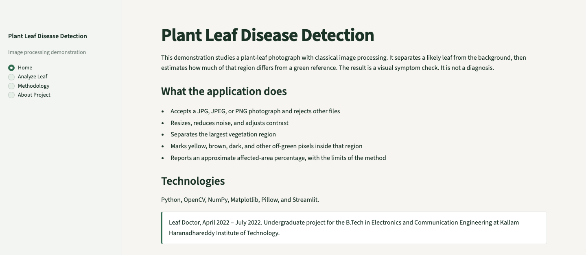
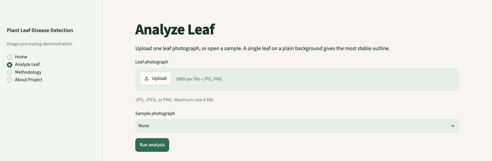
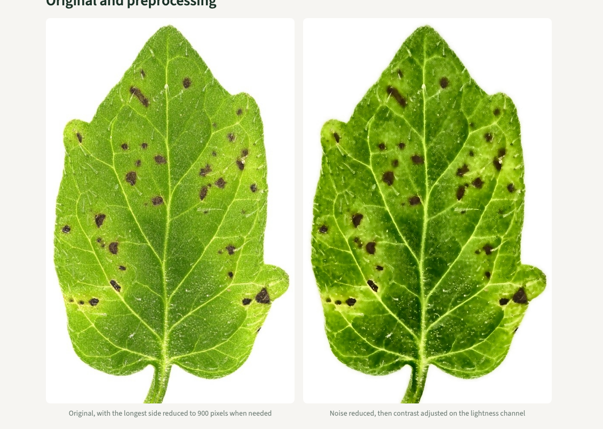
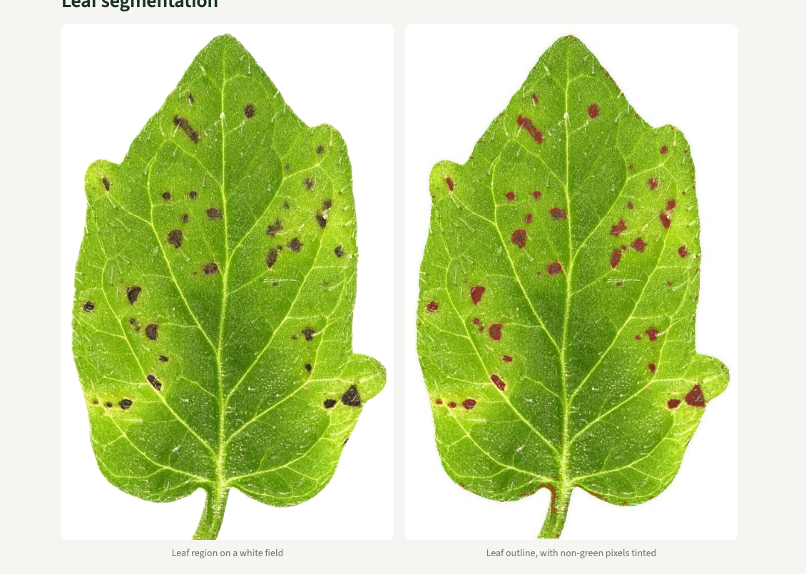
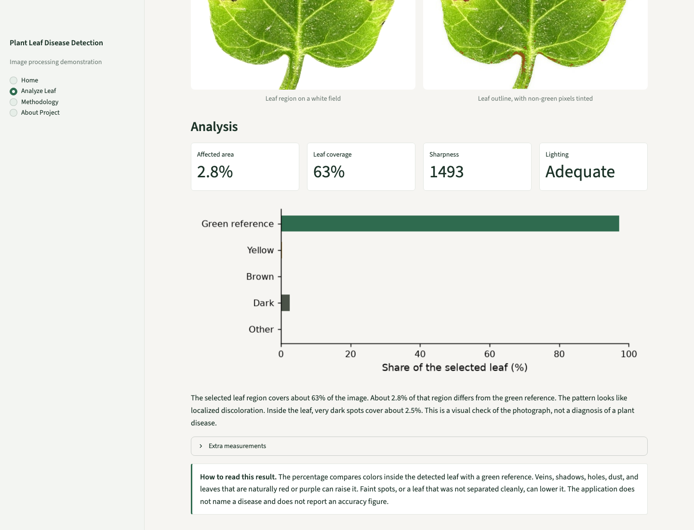

# Plant Leaf Disease Detection Using Image Processing

A small desktop demonstration that studies a plant-leaf photograph with classical image processing. It separates a likely leaf from the background and estimates how much of that region differs from a green reference. The result is a visual symptom check. It is not a diagnosis, and it does not name a disease.

## Academic background

Leaf Doctor was completed from April 2022 to July 2022 for a B.Tech in Electronics and Communication Engineering at Kallam Haranadhareddy Institute of Technology. It studies leaf photographs with image processing and reports visible signs of discoloration.

## Technology

- Python 3.12
- OpenCV, NumPy, and Pillow
- Matplotlib
- Streamlit
- pytest

## Features

- Upload a JPG, JPEG, or PNG, or open one of the sample photographs
- Reject other file types, empty files, and files larger than 8 MB
- Resize, reduce noise, and adjust contrast
- Separate the largest vegetation region
- Mark compact dark spots and other off-green pixels inside that region
- Show the original, the preprocessed image, the segmented leaf, the highlighted regions, and an approximate affected-area percentage
- State the limits of the measurement on the same page

## Methodology

Color shares are counted on the resized photograph. The leaf outline is taken from the denoised image. Contrast adjustment is shown for inspection and is not used in the percentage.

1. Check the file type, size, and that the image can be decoded.
2. Shrink the longest side to 900 pixels when the photograph is larger.
3. Apply a bilateral filter to reduce speckle.
4. Adjust contrast on the lightness channel for the display image.
5. Build a vegetation mask from excess green (`2G − R − B`) and HSV ranges for green and yellow-green, then keep the largest filled outline that covers at least 5% of the image.
6. Mark compact spots whose lightness is at least 32 levels below the surrounding leaf. Remaining pixels are grouped as yellow, brown, green, or other from CIE Lab values.
7. Report sharpness from the Laplacian and a simple dark / adequate / bright lighting check.

The full parameter list is in [docs/methodology.md](docs/methodology.md).

## Installation

Python 3.12 is required.

```bash
python3.12 -m venv .venv
source .venv/bin/activate
pip install -r requirements.txt
```

## Usage

From this folder, with the virtual environment active:

```bash
streamlit run app.py
```

Open the local address Streamlit prints. Use **Analyze Leaf**, then upload a photograph or choose a sample and press **Run analysis**.

A single leaf on a plain background gives the most stable outline. A frame filled with foliage is reported as such, because shade between leaves can be counted with the spots.

## Sample results

These figures come from the four photographs in `sample_images/` and this implementation. They are not an accuracy score.

| Photograph | Leaf region of the frame | Share marked as different from green | Reading |
| --- | ---: | ---: | --- |
| Tomato leaf on a white background | 63% | 2.8% | One leaf. About 2.5% is in compact dark spots. Localized discoloration. |
| Tomato foliage titled as healthy by the photographer | 99% | 6.9% | Not one separated leaf. Shade can be included. |
| Pepper foliage | 99% | 2.6% | Not one separated leaf. Shade can be included. |
| Basil foliage | 98% | 3.0% | Not one separated leaf. Shade can be included. |

The disease names in the sample filenames come from the photographers' captions. The application does not assign those names.

## Testing

```bash
pytest
```

The tests cover file checks, resizing, noise reduction, leaf segmentation, the affected-area total, a gray frame with no leaf, and soft or dark photographs. They also run the four sample photographs through the pipeline. There is no classifier and no accuracy percentage.

## Limitations

- The percentage is a color comparison inside the detected region. It is not a lesion count and not a diagnosis.
- Veins, shadows, holes, dust, and leaves that are naturally red or purple can raise it.
- Small specks on a plain background are the case this spot rule is aimed at. A broad, even patch can be missed.
- Several leaves, a garden background, blur, or poor light make the outline less reliable.
- The method does not use a trained classifier, so no detection accuracy is reported.

## Dataset and attribution

No dataset was bundled. Four small photographs are included for the demonstration. Their authors, licenses, and the changes made in this folder (resize, camera metadata removed) are listed in [sample_images/ATTRIBUTION.md](sample_images/ATTRIBUTION.md).

- Three photographs are CC0 1.0 (Alan Collmer; Scot Nelson).
- `healthy-tomato-leaves.jpg` is © Dwight Sipler, used under Creative Commons Attribution 2.0 Generic.

## Screenshots











## License

The source code does not have a license yet. Each sample photograph keeps the license named in `sample_images/ATTRIBUTION.md`.

## Repository

https://github.com/janibasha1024-coder/plant-leaf-disease-detection
